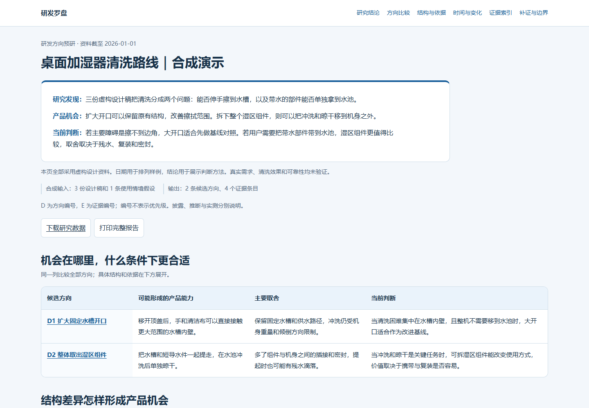

# R&D Compass · 研发罗盘

[简体中文](README.md) · English

**Turn patent and technical material into candidate product opportunities, with evidence for the trade-offs and conditions that could change the decision.**

[Download the no-account interactive demo](docs/rd-compass-synthetic-demo.zip?raw=1) · [View the synthetic input](rd-compass/references/synthetic-demo.json) · [Get the WorkBuddy skill](https://www.workbuddy.cn/share/asset?shareCode=esemC6pAN0SejrTocd72G5&sig=wvpo9epwGbdBVx04)

## A synthetic demo you can open without an account

Two concepts make a desktop humidifier easier to clean in different ways. A wider opening gives a hand and cloth more room to reach into a fixed basin. A removable water assembly lets users take the basin and its short water channel to the sink. The report shows how retained water, reassembly and sealing affect the choice.

[](docs/rd-compass-synthetic-demo.zip?raw=1)

The designs and dates are fictional. Unzip the demo and open `index.html` in a browser to compare the concepts, follow evidence references, filter the source entries and export the sample data. The report interface is in Chinese. Viewing it requires no account, API key, Python installation or agent.

## When to use it

| Starting point | What the skill helps answer |
| --- | --- |
| A product and an open brief | Which technical differences could improve a use case? |
| A company, research topic or technical approach | How else is the same task solved, and when do the alternatives transfer? |
| A defined problem or several concepts | Where does each concept fit, and what evidence would change the choice? |

R&D Compass works with source materials directly and can reuse results from [Patent Perspectives](https://github.com/KrisMiao97/patent-perspectives) or a patent reading workflow. It checks primary disclosures when a detail affects the decision and compares alternatives against a simple baseline. Each direction explains the disclosure, the design difference, the potential capability, the conditions it depends on and the remaining assumptions. The report uses separate criteria for further research and project approval.

## Get started

- **Agent Skills hosts**: Install the [rd-compass](rd-compass/) folder. Try: “Use R&D Compass to compare cleaning concepts for a desktop humidifier. Explain which parts move, what the alternatives improve and which evidence could change the choice.”
- **WorkBuddy**: Open the [R&D Compass sharing page](https://www.workbuddy.cn/share/asset?shareCode=esemC6pAN0SejrTocd72G5&sig=wvpo9epwGbdBVx04) to get the skill.
- **Rebuild the demo locally**: From the repository root, run the command below with Python 3.10 or later. The renderer uses the standard library.

```sh
python rd-compass/scripts/render_report.py rd-compass/references/synthetic-demo.json --output synthetic-report.html
```

For a real research task, supply your material or use data sources authorized in your host. See the [workflow](rd-compass/references/research-workflow.md), [report design guide](rd-compass/DESIGN.md) and [data format](rd-compass/references/output-format.md). The skill instructions and reference guides are in Chinese.

[Changelog](CHANGELOG.md) · [WorkBuddy listing copy](workbuddy/marketplace-copy.md)
