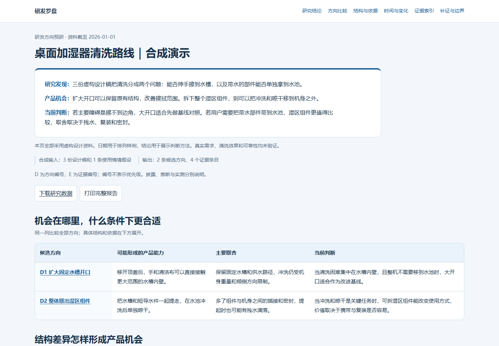

# R&D Compass · 研发罗盘

[简体中文](README.md) · English · **v0.4.0**

**Explain why a product needs a technology, how existing approaches work and evolve, and which product changes are worth investigating.** Choose a report structure that fits the research question.

## Real case | Do you need to open the lid to clean the kettle filter?

**[Open the interactive report (Chinese)](https://htmlpreview.github.io/?https://github.com/KrisMiao97/rd-compass/blob/b98e532c4417757f80e1bcd86ad156ef80183ef6/docs/kettle/index.html)** · [Reproduce it with Codex](#install-and-try-a-first-prompt) · [GitHub text version](docs/kettle/README.md)

- **Remove the filter at the spout.** In [US5672274A](https://patents.google.com/patent/US5672274A/en), the filter lifts out from the top of the spout while the mounting frame stays on the kettle body.
- **Move the filter with the lid.** In [EP0676161A1](https://patents.google.com/patent/EP0676161A1/en), the lid supports the filter. Opening the lid moves the filter away from its engagement with the inner wall near the spout.

The demo compares maintenance steps and points to relevant claims and figures in the two published documents. Cleaning performance and service life would require measurements.

## Install and try a first prompt

Follow the [Windows PowerShell installation steps](README.md#安装并试问) in an empty project folder. Open the same folder in Codex and send this prompt. The case data comes with the skill, so you can reproduce the report without a patent database account.

```text
Use the project's $rd-compass skill to reproduce the kettle filter case from .agents/skills/rd-compass/assets/kettle-case.json. Keep both patent numbers and source links. Compare the routes when the lid must stay in place and when it can be opened. Run the skill's Python report generator, save the bundle to kettle-report, check its integrity, and give me the path to kettle-report/report.html.
```

<details>
<summary>Research exercise using the two patent publications</summary>

```text
Use $rd-compass to compare the electric-kettle filters in these two patents.
https://patents.google.com/patent/US5672274A/en
https://patents.google.com/patent/EP0676161A1/en
Explain where each filter sits, how water flows through it while pouring,
and how to remove it for cleaning. Compare cases where the lid must stay
in place and where it can be opened. Cite the relevant claims and figures,
and identify what performance measurements are still needed.
```

</details>

[Use the skill in WorkBuddy](https://www.workbuddy.cn/share/asset?shareCode=esemC6pAN0SejrTocd72G5&sig=wvpo9epwGbdBVx04)

## Three research purposes

| Purpose | Main questions |
|---|---|
| Technical understanding and evolution | Product context, problems, dated disclosures, mechanisms and changes |
| R&D opportunity exploration | Proposed capabilities, comparisons, costs and conditions |
| Route comparison and project preparation | Trade-offs under stated goals and constraints, with a plan when requested |

Modes can be combined. Existing approaches and future opportunities are distinct, linked concepts. Research priority and a comparison baseline do not mean superior measured performance. A technical explanation does not automatically become a test assignment.

## A fictional demo

[Download the offline demo](docs/rd-compass-synthetic-demo.zip?raw=1) · [View the new synthetic input](rd-compass/assets/report-data.v2.example.json)

[](docs/rd-compass-synthetic-demo.zip?raw=1)

Fixed and removable connections illustrate how maintenance access differs. All sources, identifiers and dates are fictional. Unzip and open `index.html` to explore the Chinese-language report without an account, API key or Python. The earlier humidifier input remains available for compatibility checks.

## What's new

- Purpose-aware report order; existing approaches and candidate opportunities are linked separately.
- Explicit event dates and types; time order does not imply inheritance or adoption.
- Separate reading, review and card associations, with multiple locations in one source.
- A report, reading catalog, CSV, research data and hash manifest generated from one input.
- Content review separated from structural checks; schema 1 remains supported without fabricated migration data.

## Get started

Install the [rd-compass](rd-compass/) folder in an Agent Skills host. For WorkBuddy, see the [R&D Compass sharing page](https://www.workbuddy.cn/share/asset?shareCode=esemC6pAN0SejrTocd72G5&sig=wvpo9epwGbdBVx04).

Use the skill independently or reuse records from [Patent Perspectives](https://github.com/KrisMiao97/patent-perspectives) or patent-batch-reader. Real research uses your material and authorized data sources. Instructions and report text are primarily Chinese; the WorkBuddy entry has bilingual discovery metadata.

Python 3.10+, standard library only:

```sh
python rd-compass/scripts/render_report.py rd-compass/assets/report-data.v2.example.json --bundle demo
python rd-compass/scripts/render_report.py --check-bundle demo
python -m unittest discover -s rd-compass/tests -v
python scripts/package_release.py
```

32 automated tests pass. Offline reports were checked at five viewport widths. These checks do not validate patent facts or prove a source was read.

[Changelog](CHANGELOG.md) · [Data format](rd-compass/references/output-format.md) · [WorkBuddy listing copy](workbuddy/marketplace-copy.md)
