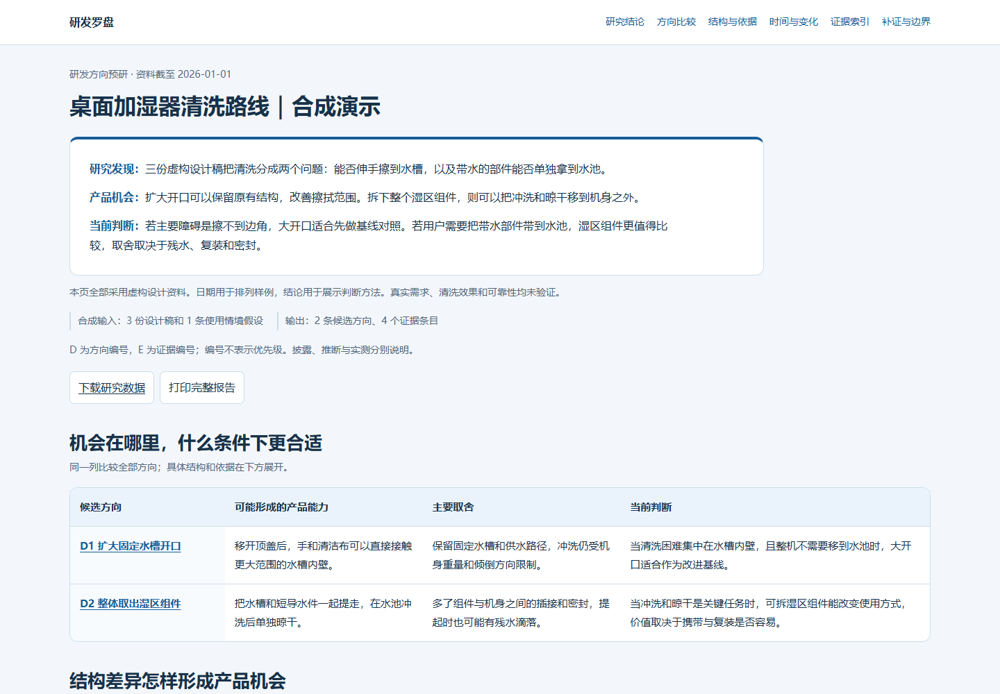

# 研发罗盘 · R&D Compass

[GitHub 通用安装包 v0.7.4](https://raw.githubusercontent.com/KrisMiao97/rd-compass/429ca91577437068d9386ec32c398f1a5ae3ec08/downloads/rd-compass-v0.7.4.zip) · WorkBuddy 分享页为独立更新渠道。

简体中文 · [English](README.en.md) · **v0.7.4**

**解释产品为什么需要某种技术、各条路线怎样工作和发展，并据此发现有条件的研发机会。** 可按任务切换到路线比较与立项准备。

## 真实案例｜清理水壶滤件，要先打开壶盖吗？

**[在线打开互动报告](https://htmlpreview.github.io/?https://github.com/KrisMiao97/rd-compass/blob/b98e532c4417757f80e1bcd86ad156ef80183ef6/docs/kettle/index.html)** · [在 Codex 跑一遍](#安装并试问) · [GitHub 文字版](docs/kettle/README.md)

- **从壶嘴取出**：[US5672274A](https://patents.google.com/patent/US5672274A/en) 的滤件可从壶嘴上方取出，连接框架留在壶体上。
- **随壶盖移开**：[EP0676161A1](https://patents.google.com/patent/EP0676161A1/en) 中，壶盖支承滤件。打开壶盖时，滤件离开壶嘴内侧的接合位置。

演示比较两种路线的维护动作，并标出相关权利要求和附图。案例范围限于这两件公开专利的相关内容，清洗效果和寿命仍需实测。

**[看两种滤件怎么取出来 · 专利产品三维图解](https://krismiao97.github.io/patent-review-kit/studio-kettle.html)**　转动模型，切换到“取出时”，观察固定框架、壶盖和滤件各自的位置。

<details>
<summary>想扩查其他申请人采用的滤件结构？</summary>

已给的两篇公开文本足以复现本例。扩展到其他申请人或境外同族时，可提供更多公报，也可使用已有的授权检索来源。需要申请智慧芽 MCP 权限时，可从下方表单申请积分。已有权限可直接查看配置教程，按提示添加服务地址和 MCP Key，再检查客户端能否列出专利工具。

[申请智慧芽 MCP 积分（推广链接）](https://app-u.jingsocial.com/surl/dcbC6k7e) · [智慧芽 MCP 官方配置教程](https://open.zhihuiya.com/devportal/guides/mcp-installation)

</details>

## 安装并试问

在 Windows 上准备 Codex 和 Python 3.10 或更新版本。在一个新文件夹中打开 PowerShell，将 Skill 安装到当前项目。

```powershell
$rdPackage = Join-Path ([IO.Path]::GetTempPath()) ("rd-compass-" + [guid]::NewGuid())
New-Item -ItemType Directory -Path $rdPackage | Out-Null
Invoke-WebRequest 'https://codeload.github.com/KrisMiao97/rd-compass/zip/refs/heads/main' -UseBasicParsing -OutFile "$rdPackage/rd-compass.zip" -ErrorAction Stop
Expand-Archive -LiteralPath "$rdPackage/rd-compass.zip" -DestinationPath "$rdPackage/source" -ErrorAction Stop
New-Item -ItemType Directory -Force -Path '.agents/skills' | Out-Null
Copy-Item -LiteralPath "$rdPackage/source/rd-compass-main/rd-compass" -Destination '.agents/skills/rd-compass' -Recurse -ErrorAction Stop
```

在 Codex 打开同一个文件夹，新建对话并发送下面这段任务。

```text
请使用当前项目安装的 $rd-compass，读取 .agents/skills/rd-compass/assets/kettle-case.json，复现「取出水壶滤件，需要先打开壶盖吗？」案例。使用案例包已有证据，保留两件专利的公开号和来源，说明不移动壶盖、允许开盖两种条件下怎样选路线。请用 Skill 自带的 Python 脚本生成报告包到 kettle-report，并检查报告包的完整性。完成后给出 kettle-report/report.html 的打开路径。
```

打开 `kettle-report/report.html` 查看结果。这次练习自带案例材料，无需专利数据库账号。在线演示与复现报告使用同一份案例数据，在线版采用较新的报告版式。

<details>
<summary>进阶练习：直接从两件公开专利做分析</summary>

```text
请用 $rd-compass 比较下面两件专利的电水壶滤件方案。
https://patents.google.com/patent/US5672274A/en
https://patents.google.com/patent/EP0676161A1/en
分别说明滤件装在哪里、倒水时水怎么经过滤网、清理时怎么取出。
对比必须保持壶盖原位和允许开盖两种情形，说明各条路线适用的条件。
给出对应权利要求和附图编号，并指出还缺哪些性能数据。
```

</details>

[在 WorkBuddy 使用](https://www.workbuddy.cn/share/asset?shareCode=esemC6pAN0SejrTocd72G5&sig=wvpo9epwGbdBVx04)

## 三种研究目的

| 目的 | 报告重点 |
|---|---|
| 技术理解与演进 | 产品背景、实际问题、技术时间、现有路线及其变化 |
| 研发机会探索 | 拟改善的能力、比较依据、代价与成立条件 |
| 路线比较与立项准备 | 明确目标和约束下的取舍，任务需要时单列验证安排 |

模式可以组合。现有技术路线与未来研发方向分别组织，不把每类专利自动变成一个机会，不默认写成试验任务书。研究优先、比较基准和性能优越使用不同依据。

## 无需账号的新版演示

[下载离线互动演示](docs/rd-compass-synthetic-demo.zip?raw=1) · [查看新版合成输入](rd-compass/assets/report-data.v2.example.json)

[](docs/rd-compass-synthetic-demo.zip?raw=1)

本例比较固定连接与可拆连接怎样影响滤面维护。材料、标识和日期全部虚构，用来演示阅读顺序、日期类型、证据定位，以及阅读状态和复核状态的区别。下载并解压后打开 `index.html`；查看页面不需要账号、API 密钥或 Python。旧版桌面加湿器数据仍保留用于兼容检查。

## 0.4.0 的变化

- 按研究目的选择结构，现有路线与候选方向可以多对多关联。
- 区分公开、授权、产品发布与资料日期，不凭后缀猜日期或把先后当继承。
- 阅读、复核和详细证据卡分别记录；一份资料可以定位多个具体陈述。
- 主报告、逐件页、CSV、研究数据与清单同源生成，并检查文件是否混用了旧版。
- 内容审阅与程序检查分开；保留 schema 1 兼容，不自动猜造迁移字段。

## 使用与更新

- **Agent Skills 宿主**：安装 [rd-compass](rd-compass/) 目录，使用 `$rd-compass` 或“研发罗盘”调用。
- **WorkBuddy**：[研发罗盘分享页](https://www.workbuddy.cn/share/asset?shareCode=esemC6pAN0SejrTocd72G5&sig=wvpo9epwGbdBVx04)。

可独立使用，也可复用 [专利棱镜](https://github.com/KrisMiao97/patent-perspectives) 和 patent-batch-reader 的材料、版本及实际阅读记录。真实检索依赖宿主的已授权来源，不会因安装技能获得数据库权限。

## 本地生成与检查

Python 3.10+，仅使用标准库：

```sh
python rd-compass/scripts/render_report.py rd-compass/assets/report-data.v2.example.json --bundle demo
python rd-compass/scripts/render_report.py --check-bundle demo
python -m unittest discover -s rd-compass/tests -v
python scripts/package_release.py
```

32 项自动测试覆盖兼容、日期、记录关联、计划边界及成果同步。另已检查离线页面、五种宽度和证据交互；测试不证明专利事实或真实阅读完成。

[研究工作流](rd-compass/references/research-workflow.md) · [设计规范](rd-compass/DESIGN.md) · [数据约定](rd-compass/references/output-format.md) · [版本记录](CHANGELOG.md) · [WorkBuddy 双语文案](workbuddy/marketplace-copy.md)
