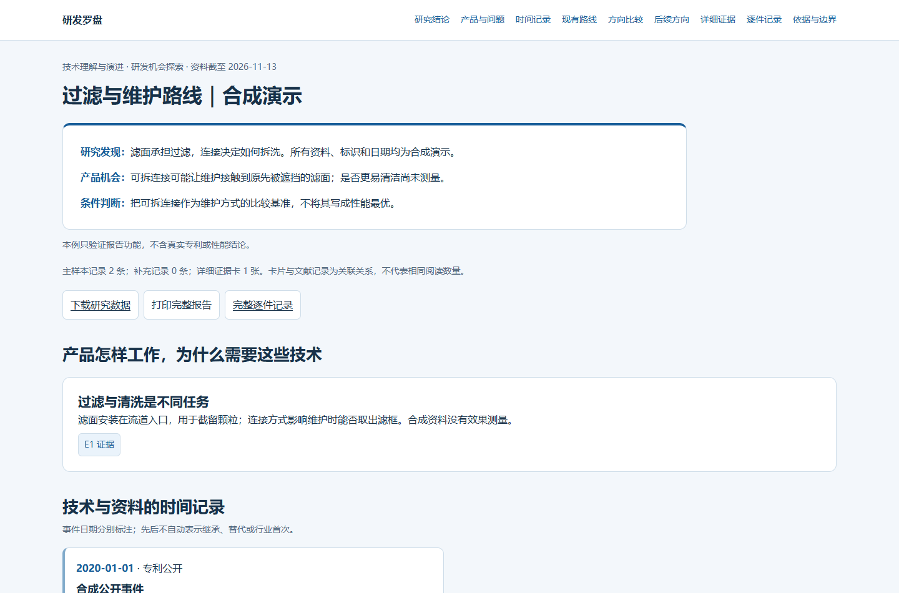

# 研发罗盘 · R&D Compass

简体中文 · [English](README.en.md) · **v0.4.0**

**解释产品为什么需要某种技术、各条路线怎样工作和发展，并据此发现有条件的研发机会。** 可按任务切换到路线比较与立项准备。

[下载 WorkBuddy v0.4.0 更新包](workbuddy/rd-compass-workbuddy-0.4.0.zip?raw=1) · [下载离线互动演示](docs/rd-compass-synthetic-demo.zip?raw=1) · [查看新版合成输入](rd-compass/assets/report-data.v2.example.json)

## 三种研究目的

| 目的 | 报告重点 |
|---|---|
| 技术理解与演进 | 产品背景、实际问题、技术时间、现有路线及其变化 |
| 研发机会探索 | 拟改善的能力、比较依据、代价与成立条件 |
| 路线比较与立项准备 | 明确目标和约束下的取舍，任务需要时单列验证安排 |

模式可以组合。现有技术路线与未来研发方向分别组织，不把每类专利自动变成一个机会，不默认写成试验任务书。研究优先、比较基准和性能优越使用不同依据。

## 无需账号的新版演示

[](docs/rd-compass-synthetic-demo.zip?raw=1)

本例比较固定连接与可拆连接怎样影响滤面维护。材料、标识和日期全部虚构，用来演示阅读顺序、日期类型、证据定位，以及阅读状态和复核状态的区别。下载并解压后打开 `index.html`；查看页面不需要账号、API 密钥或 Python。旧版桌面加湿器数据仍保留用于兼容检查。

## 0.4.0 的变化

- 按研究目的选择结构，现有路线与候选方向可以多对多关联。
- 区分公开、授权、产品发布与资料日期，不凭后缀猜日期或把先后当继承。
- 阅读、复核和详细证据卡分别记录；一份资料可以定位多个具体陈述。
- 主报告、逐件页、CSV、研究数据与清单同源生成，并检查文件是否混用了旧版。
- 内容审阅与程序检查分开；保留 schema 1 兼容，不自动猜造迁移字段。

## 使用与更新

- **Agent Skills 宿主**：安装 [rd-compass](rd-compass/) 目录，使用 `$rd-compass` 或“研发罗盘”调用。
- **WorkBuddy 更新包**：下载上方 v0.4.0 ZIP，在技能页选择“添加技能 → 上传技能”。包的根目录含 `SKILL.md`、双语说明及离线演示。参见[更新说明](workbuddy/UPDATE.md)。
- **已有分享入口**：[研发罗盘 WorkBuddy 分享页](https://www.workbuddy.cn/share/asset?shareCode=esemC6pAN0SejrTocd72G5&sig=wvpo9epwGbdBVx04)。此处保留原入口；本仓库发布更新包不代表该分享页已更新至同一版本。

可独立使用，也可复用 [专利棱镜](https://github.com/KrisMiao97/patent-perspectives) 和 patent-batch-reader 的材料、版本及实际阅读记录。真实检索依赖宿主的已授权来源，不会因安装技能获得数据库权限。

## 本地生成与检查

Python 3.10+，仅使用标准库：

```sh
python rd-compass/scripts/render_report.py rd-compass/assets/report-data.v2.example.json --bundle demo
python rd-compass/scripts/render_report.py --check-bundle demo
python -m unittest discover -s rd-compass/tests -v
python scripts/package_release.py
```

32 项自动测试覆盖兼容、日期、记录关联、计划边界及成果同步。另已检查离线页面、五种宽度和证据交互；测试不证明专利事实或真实阅读完成。WorkBuddy 包已解压运行检查，未声明在客户端完成导入。

[研究工作流](rd-compass/references/research-workflow.md) · [设计规范](rd-compass/DESIGN.md) · [数据约定](rd-compass/references/output-format.md) · [版本记录](CHANGELOG.md) · [WorkBuddy 双语文案](workbuddy/marketplace-copy.md)
